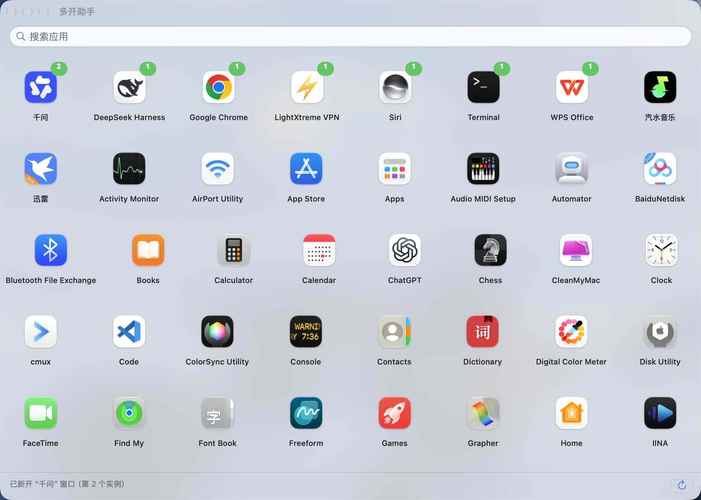

# 多开助手 (MultiOpener)

macOS 应用多开工具 —— 一个纯原生 AppKit 打造的 Launchpad 风格启动器，让任何应用都能双开、三开、N 开。



## 功能特性

- 🎛 **全应用多开**：实时扫描本机所有应用（/Applications、~/Applications、系统应用等），点击卡片即开新实例
- 🧬 **Chromium/Electron 智能槽位**：自动识别 Chrome/千问/VS Code 等 Chromium 系应用，通过独立 `user-data-dir` 数据槽位绕过单实例锁，每个实例可登录不同账号
- 🏗 **沙盒应用容器适配**：App Store 沙盒应用的数据槽位自动放入其容器目录，符合沙盒规范
- 🪟 **液态玻璃界面**：macOS 26 Liquid Glass 风格，实时透出桌面内容的毛玻璃背景 + 透明标题栏
- 🧭 **Launchpad 式网格**：无框卡片、自适应列数（窗口越宽每行越多）、悬停高亮、实时运行实例数角标
- 🔍 **即时搜索**：大号搜索框，输入即过滤，结果始终贴顶展示
- 🛡 **失败可见**：启动失败会弹窗说明原因，而不是默默无闻
- 🧹 **环境自清洁**：自动剥离 `ELECTRON_*`/`NODE_*` 等注入变量，从任何宿主环境启动都不会污染目标应用

## 使用方法

1. 从 [Releases](../../releases) 下载最新版 `MultiOpener-vX.X.zip`
2. 解压出 `多开助手.app`，拖入 `/Applications`
3. 打开多开助手，点击任意应用卡片即可多开

> 首次启动某应用 = 正常打开；已运行时再点 = 开新实例。卡片右上角的绿色角标显示当前实例数。
>
> 若系统提示"无法验证开发者"：右键点应用 → 打开 → 再点"打开"（或系统设置 → 隐私与安全性 → 仍要打开）。

## 从源码构建

需要 Xcode Command Line Tools（无需完整 Xcode）：

```bash
# 1. 编译并打包出 多开助手.app（在 build/ 目录）
./build.sh

# 2.（可选）直接安装到 /Applications 并启动
./build.sh --install
```

也可单独重新生成应用图标（需要 Python + Pillow）：

```bash
python3 compose_icon.py   # 生成 AppIcon.iconset + AppIcon.icns
```

## 多开原理

| 应用类型 | 策略 |
|---|---|
| Chromium/Electron（Chrome、千问、VS Code、汽水音乐…） | `open -n <app> --args --user-data-dir=<槽位N>`，每个实例独立数据目录；沙盒应用槽位放容器内 |
| 普通应用 | `open -n` 新开实例 + 运行数校验；若应用自带单实例锁则明确提示不支持 |
| 未运行 | 先正常启动，验证进程存活 |

实例计数用 `NSRunningApplication`（按 Bundle ID），兼容 macOS 26 的 Cryptex 系统应用。
槽位命名读取 plist 的原始 `CFBundleName`（避免本地化名称导致槽位漂移），含 3 次重试与 20 秒 pending 标记，防止慢启动时重复开窗。

## 技术栈

- **单文件 Swift**（~700 行），纯 AppKit，无任何第三方依赖
- NSVisualEffectView 液态玻璃 / NSStackView 翻转网格 / NSScrollView contentLayoutGuide 布局
- 后台线程扫描 + 图标缓存（94 个应用秒开不卡顿）
- CLI 双模式：`MultiOpener --launch <path>` / `--count <path>` / `--list` 方便脚本调用

## 许可证

[MIT](LICENSE)
